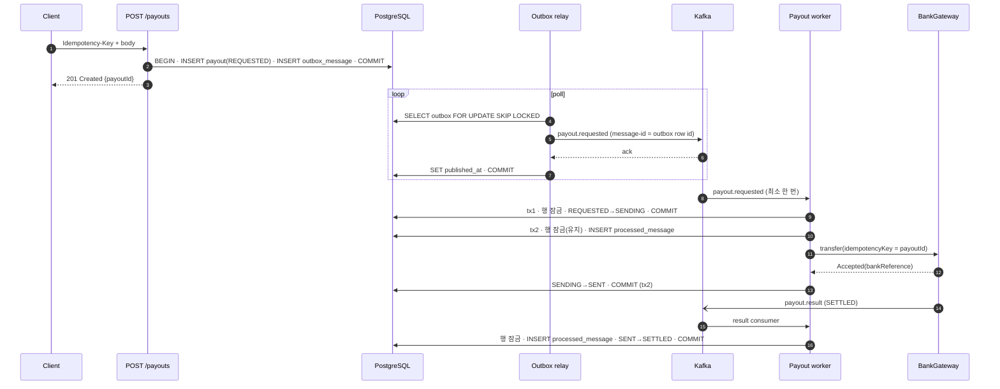
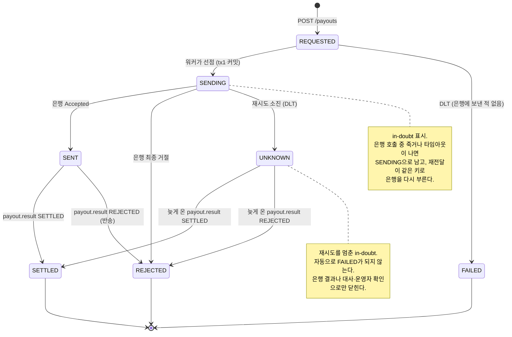

# idempotent-payout-worker

지급이 **사실상 한 번(effectively-once)** 나가게 하는 워커. Kafka의 최소 한 번 전달(at-least-once) 위에서 경로의 모든 홉을 멱등으로 만든다. 은행에 보낸 지급이 결과를 확정하지 못한 채 재시도를 다 쓰면, 마지막 오류가 무엇이든 실패로 단정하지 않고 `UNKNOWN`(결과 모름)으로 둔다. 확정은 늦게 오는 은행 결과와 대사로만 한다. 이 한계는 [아래](#은행-쪽-idempotency-key와-그-한계)에 적었다.

Kotlin · Spring Boot 3.5 · Spring Kafka · Spring Data JPA · PostgreSQL · Flyway · Testcontainers

---

## 문제

지급은 되돌리기 어렵다. 한 번 더 나간 돈은 고객에게 연락해 돌려받아야 하고, 안 나간 돈은 장애 보고서가 된다. 그런데 이 경로에 있는 것들은 하나같이 "최소 한 번"만 보장한다.

- 클라이언트는 응답을 못 받으면 같은 요청을 다시 보낸다.
- Kafka는 컨슈머가 오프셋을 커밋하기 전에 죽으면 같은 레코드를 다시 준다.
- 은행 호출은 타임아웃이 나면 돈이 나갔는지 알 수 없다.

Kafka 트랜잭션(exactly-once semantics)은 Kafka 안에서만 원자적이다. PostgreSQL 커밋과 은행 이체를 한 트랜잭션으로 묶을 방법은 없다. 그래서 이 레포는 **전달은 여러 번 일어난다고 가정하고, 각 홉에서 중복을 걸러 결과가 한 번만 반영되게** 만든다.

| 중복이 생기는 곳 | 막는 장치 |
|---|---|
| 클라이언트 재시도, 같은 키 동시 요청 | `Idempotency-Key` 유니크 제약 + 요청 본문 fingerprint |
| 커밋 직후 발행 실패 / 발행 직후 커밋 실패 | transactional outbox (지급 저장과 이벤트 기록이 한 트랜잭션) |
| outbox 재발행, Kafka 재전달, 재시도 토픽 hop | `message-id` 헤더 + `processed_message` (consumer, message_id) PK |
| 같은 지급에 대한 서로 다른 메시지가 동시에 처리 | 지급 행 `SELECT ... FOR UPDATE` + 상태 머신 |
| 은행은 이체했는데 우리 커밋 전에 죽음 | `SENDING` 선커밋 + 은행 쪽 idempotency key = payout id |
| 은행 결과 이벤트 중복 | `processed_message` + 이미 같은 상태면 no-op |

## 흐름



### 상태



허용 전이는 `PayoutStatus` 한 곳에 있고, 그 밖의 전이는 `IllegalStatusTransitionException`으로 거부한다. DB에도 상태 값 check 제약이 있다.

## 설계 결정과 트레이드오프

### Outbox vs 직접 발행

| | 장점 | 단점 |
|---|---|---|
| 커밋 후 직접 발행 | 단순, 지연 없음 | 커밋과 발행 사이에 죽으면 지급이 `REQUESTED`에 영원히 남는다 |
| 발행 후 커밋 | – | 커밋이 실패하면 존재하지 않는 지급에 대한 메시지가 나간다 |
| **outbox (채택)** | 지급 저장과 이벤트 기록이 원자적 | 폴링 지연(`poll-interval`), 테이블 정리 필요, relay가 최소 한 번이라 중복 발행 가능 |

relay는 `FOR UPDATE SKIP LOCKED`로 행을 잠그고, 브로커 ack를 받은 행에만 `published_at`을 찍는다.

- 실패하거나 마감까지 ack가 없는 행만 다음 주기로 넘어간다. 영영 발행되지 않는 행 하나가 나머지를 붙잡지 않는다(그 행은 경고 로그로 남는다).
- 마감(`payout.outbox.send-timeout`, 5s)은 배치 하나에 하나다. send를 시작하는 시간과 ack를 기다리는 시간을 함께 센다. 마감이 지나면 새 send를 시작하지 않는다.
- `KafkaTemplate.send()`는 브로커 메타데이터가 없으면 호출한 스레드를 막는다. 그래서 프로듀서의 `max.block.ms`(2s)와 `delivery.timeout.ms`(4s)를 마감보다 짧게 잡았다. 브로커가 죽어도 행 잠금은 최대 `send-timeout + max.block.ms`만 쥔다. 클라이언트 기본값(60s 메타데이터 대기, 2분 전달)이면 분 단위로 쥐게 된다. `OutboxRelayBrokerDownIntegrationTest`가 이 상한을 실제 프로듀서로 확인한다.
- 발행 후 커밋이 실패하면 같은 행이 다시 나간다. `message-id` 헤더가 outbox 행 id라서 컨슈머가 걸러낸다.
- relay 여럿이 같은 테이블을 동시에 비워도 SKIP LOCKED 덕에 한 행은 한 relay만 집는다. `OutboxRelayConcurrencyIntegrationTest`가 실제 PostgreSQL에서 relay 다섯 개(예약 실행 포함)로 300행을 비우고 행마다 정확히 한 번 발행됐는지 본다. 잠금 절을 빼면 이 테스트는 실패한다.

WAL을 읽는 CDC(Debezium)로 바꾸면 폴링이 사라지지만 운영할 인프라가 늘어난다.

### 멱등 키를 어디에 두나

**API 요청 키**는 `payout.idempotency_key` 유니크 제약으로 지킨다. 지급 생성과 같은 행이라 별도 테이블이나 분산 락 없이 원자적이다. 같은 키 동시 요청은 유니크 인덱스에서 줄을 서고, 진 쪽은 이긴 쪽 행을 다시 읽어 돌려준다. 키가 같은데 본문 fingerprint(업무 필드를 고정된 순서로 이은 값의 SHA-256)가 다르면 409.

- 재요청 응답은 "원래 요청이 만든 같은 지급"이다. 상태 코드(201)와 `payoutId`는 같고, `Idempotent-Replayed: true` 헤더가 붙고, 본문의 `status`는 현재값이다. 원래 응답 바이트를 그대로 저장해 돌려주는 방식(Stripe식)은 별도 테이블이 필요해 하지 않았다.
- 키는 전역 범위이고 만료되지 않는다. 멀티테넌트라면 `(client_id, key)` 유니크와 보존 기간이 필요하다.

**메시지 처리 기록**은 `processed_message`를 지급 상태와 **같은 DB, 같은 트랜잭션**에 둔다. Redis 같은 외부 저장소에 두면 "처리 표시는 됐는데 상태 커밋은 실패"(유실)나 그 반대(중복)가 생긴다. 기록은 `INSERT ... ON CONFLICT DO NOTHING`이라 동시에 같은 id를 넣으면 한쪽이 PK에서 기다렸다가 0건으로 끝난다.

### 은행 호출을 행 잠금 안에서 하는 이유

워커는 트랜잭션 두 개를 쓴다.

1. **선점(tx1)**: 지급 행을 잠그고 `REQUESTED→SENDING`을 커밋한다. 은행 호출 중 죽어도 `SENDING`이 남아 "결과 모름"이 보인다.
2. **이체(tx2)**: 행을 다시 잠그고 `processed_message`를 기록하고, **잠금을 쥔 채로** 은행을 부르고, `SENT/REJECTED`를 같은 트랜잭션에 커밋한다.

잠금을 쥔 채 외부 호출을 하는 것은 의도한 것이다. 같은 지급을 처리하려는 다른 컨슈머·스레드는 잠금 앞에서 기다렸다가, 들어왔을 때 이미 기록된 메시지나 `SENT` 상태를 보고 빠진다. 그래서 은행 호출은 한 번이다(`ProcessPayoutConcurrencyIntegrationTest`).

대가도 분명하다.

- 은행 응답을 기다리는 동안 DB 커넥션 하나와 행 잠금을 쥔다. 커넥션 풀은 동시에 일할 수 있는 컨슈머 스레드 수보다 커야 한다. 본 토픽 2개 × 3 + 재시도·DLT 토픽 10개 × 1 = 16이라 풀은 30이다(`maximum-pool-size`). 재시도·DLT 토픽은 대부분 놀고 있어서 스레드를 하나씩만 준다(`retry-concurrency`).
- 은행 클라이언트 타임아웃이 잠금 보유 시간의 상한이다. `BankGateway` 구현은 반드시 타임아웃을 걸어야 한다. 은행이 응답 없이 매달리면 그 지급의 행 잠금도 같이 매달린다.
- 은행이 느려지면 워커 스레드가 함께 묶인다. API 커넥션까지 굶지 않게 하려면 풀을 분리해야 한다.

대안은 `claimed_until` 같은 lease 컬럼이다. 커넥션을 쥐지 않지만, lease가 은행 호출보다 짧으면 두 워커가 동시에 은행을 부른다(은행 키가 막아 주긴 한다). lease 만료를 기다리는 메시지를 어떻게 재시도할지도 정해야 한다. 정확성을 설명하고 테스트로 보이기 쉬운 쪽을 골랐다.

### 은행 쪽 idempotency key와 그 한계

"은행 호출은 성공했는데 우리 커밋 전에 죽은" 경우는 DB만으로는 막을 수 없다. 은행에 이미 돈이 나갔고 우리 기록은 롤백됐다. 재전달된 메시지는 `SENDING`을 보고 은행을 **같은 idempotency key**로 다시 부르고, 은행은 새 이체 대신 원래 결과(같은 `bankReference`)를 돌려준다.

키는 **payout id**다. 메시지 id가 아닌 이유는, 운영자가 다시 발행하거나 outbox가 새 행을 만들면 메시지 id는 바뀌지만 "이 이체 한 건"의 정체는 payout id이기 때문이다. 지급의 금액·수취인은 생성 후 바뀌지 않으므로 같은 키에 다른 내용이 실려 나갈 일도 없다.

이 장치가 지켜 주는 범위는 좁다.

1. **보존 기간**: 은행은 키를 영원히 기억하지 않는다. 기억 창이 지난 뒤 같은 키로 다시 보내면 새 이체가 된다. 그래서 재시도는 초~분 단위에서 끝내고, 소진되면 `FAILED`나 `UNKNOWN`으로 멈춘다. 둘 다 워커가 다시 은행을 부르지 않는다. 수동 재처리는 대사로 확인한 뒤 **새 지급**으로 한다.
2. **지원 여부와 의미가 은행마다 다르다**: 클라이언트 키를 받지 않고 거래 고유번호로만 중복을 거르는 연동도 있고, 중복이면 원래 결과 대신 "중복" 오류를 주는 곳도 있다. 그런 경우 어댑터는 재전송 전에 거래 조회(inquiry)로 결과를 확인해야 한다. `BankGateway` 포트의 계약("같은 키 = 원래 결과")을 지키는 것은 어댑터의 몫이다.
3. **은행에 보낸 뒤 재시도 소진**: 실제 시스템은 타임아웃이 요청 전인지 후인지 구분할 수 없다. 앞선 시도에서 돈이 나간 뒤 은행이 내려가, 마지막 오류만 "처리 안 함"으로 보일 수도 있다. 그래서 `SENDING`까지 간 지급은 재시도를 다 쓰면 마지막 오류와 상관없이 `UNKNOWN`이 된다. `FAILED`는 은행에 한 번도 보내지 않은 `REQUESTED`에서만 나온다. `UNKNOWN`은 자동으로 `FAILED`가 되지 않는다. 은행 결과 이벤트(`SETTLED`/`REJECTED`)가 오면 그걸로 확정하고, 대사에서 은행 기록이 깨끗하게 하나 있으면 `SETTLED` 확정 후보로, 없으면 운영자 확인 대상으로 보고한다(은행 처리가 늦을 수 있으니 기록이 없다고 실패로 보지 않는다).
   - **운영 원칙: `UNKNOWN` 지급과 같은 업무로 새 지급을 만들지 않는다.** 먼저 대사나 은행 조회로 결과를 확인한다. 확인 없이 다시 보내면 두 번 지급될 수 있다.
4. **다른 키로 온 같은 업무**: 클라이언트가 같은 정산 건을 다른 `Idempotency-Key`로 두 번 보내면 두 지급이 된다. 이건 업무 키(정산 배치 id + 수취인 등) 유니크 제약으로 상위에서 막아야 한다.

### 재시도 토픽 vs 블로킹 재시도

| | 블로킹 재시도 (`DefaultErrorHandler` + backoff) | **재시도 토픽 (채택)** |
|---|---|---|
| 순서 | 파티션 순서 유지 | 같은 키의 순서가 깨진다 |
| 다른 메시지 영향 | 실패 한 건이 backoff 동안 파티션 전체를 막는다 | 원래 파티션은 계속 흐른다 |
| 구성 | 단순 | 토픽·컨슈머가 늘어난다 (`-retry-0..n`, `-dlt`) |

지급 하나당 `payout.requested` 메시지는 하나이고, 순서는 상태 머신과 행 잠금이 대신 지키므로 순서를 포기해도 된다. 은행 장애 한 건이 다른 지급을 붙잡지 않는 쪽이 낫다.

재시도 정책은 토픽마다 다르다.

- `payout.requested`: 4회(1s → 2s → 4s, 최대 30s). 은행 오류는 몇 초 안에 풀리거나 아예 안 풀린다. `payout.kafka.retry.*`
- `payout.result`: 6회(5s → 15s → 45s → 135s → 300s, 약 8분). 결과가 우리 `SENT` 커밋보다 먼저 올 수 있고, 워커가 죽었다면 그 커밋은 리밸런스와 재전달을 기다려야 한다. 창이 짧으면 결과가 DLT로 가고 지급이 `SENT`에 머문다. `payout.kafka.result-retry.*`. `PayoutPipelineIntegrationTest`가 "결과가 먼저 도착 → 재시도 토픽 → 워커가 `SENT` 커밋 → `SETTLED`" 경로를 Kafka로 확인한다.

예외는 재시도해서 답이 바뀌는지로 나눈다.

| 상황 | 처리 |
|---|---|
| `TransientBankException` — 은행이 아무것도 안 했다고 확답 | 재시도 |
| `BankTimeoutException` — 결과 모름 | 같은 키로 재시도 |
| `PayoutNotSentYetException` — 결과가 우리 `SENT` 커밋보다 먼저 도착 | 재시도 |
| `TransferOutcome.Rejected` — 은행의 최종 거절 | 예외가 아니다. `REJECTED`로 끝, 재시도 없음 |
| `InvalidMessageException`, `PayoutNotFoundException`, `IllegalStatusTransitionException` | 곧바로 DLT |

### DLT 운영

- `payout.requested-dlt`에 떨어진 지급은 상태만으로 정한다. 이미 `SENT` 이후거나 `UNKNOWN`이면 건드리지 않는다.

  | 상태 | 결과 |
  |---|---|
  | `REQUESTED` (은행에 보낸 적 없음) | `FAILED` |
  | `SENDING` (은행에 보냈을 수 있음) | `UNKNOWN` — 마지막 오류가 무엇이든 |

- `failureReason`에는 API로 보여도 되는 코드만 남긴다: `RETRIES_EXHAUSTED_BANK_UNAVAILABLE`, `BANK_OUTCOME_UNKNOWN`(마지막 오류가 타임아웃), `INVALID_MESSAGE`, `PROCESSING_FAILED`. 코드는 마지막 오류의 이름일 뿐 상태를 정하지 않는다. 원래 토픽, 예외 클래스, 메시지 원문은 error 로그에만 남긴다.
- DLT 핸들러가 실패하면 원인에 따라 다르게 한다. DB 장애처럼 다시 하면 될 일은 예외를 다시 던져 레코드를 DLT에 되돌린다(`ALWAYS_RETRY_ON_ERROR`). 파싱할 수 없거나 지급이 없는 레코드는 다시 해도 같으므로 error 로그만 남기고 멈춘다.
- `message-id` 헤더가 없는 것처럼 메시지 자체가 잘못되면 곧바로 DLT로 가고, 본문을 읽을 수 있고 지급이 아직 `REQUESTED`면 `FAILED`가 된다. 은행에 닿기 전이라 돈은 나가지 않았고, 클라이언트가 끝나지 않는 `REQUESTED`를 보는 것보다 낫다고 판단했다. 프로듀서 버그 하나로 정상 지급이 실패 처리될 수 있다는 뜻이기도 하다.
- `payout.result-dlt`는 자동으로 바꾸지 않는다. 대개 정산 통지를 포기한 `SENT` 지급이므로 error 로그로 알리고 사람이 다시 반영한다(오래된 `SENT`를 찾아 다시 반영하는 작업은 다음 할 일).
- DLT 적재량과 `SENDING` 체류 시간이 경보 기준이다(메트릭은 다음 할 일).
- 원인을 고친 뒤 DLT 레코드를 원래 토픽에 다시 넣어도, 워커는 `FAILED`·`UNKNOWN` 지급을 다시 보내지 않는다. 의도된 동작이다. 다시 보내려면 대사로 은행에 이체가 없음을 확인하고 새 `Idempotency-Key`로 새 지급을 만든다. `UNKNOWN`은 그 확인 전에는 절대 새로 만들지 않는다.

### 금액 표현

`Money(amountMinor: Long, currency: Currency)`. 통화의 최소 단위(KRW는 원, USD는 센트) 정수와 ISO 4217 통화를 함께 둔다.

- `BigDecimal`은 `1.0`과 `1.00`이 `equals`로 다르고, 스케일과 반올림 규칙을 모든 경계에서 맞춰야 한다. 정수는 비교가 정확하고 은행 이체 금액과 1:1로 대응한다.
- 소수 자릿수는 `Currency.defaultFractionDigits`가 알려 준다(KRW 0, USD 2, KWD 3). 표시할 때만 쓴다.
- API 필드도 `amountMinor`로 이름에 단위를 드러낸다. 환율 변환은 범위 밖이다.

### 개인정보

계좌번호는 Kafka 메시지에 싣지 않는다(워커가 DB에서 다시 읽는다). `BeneficiaryAccount.toString()`과 API 응답은 마스킹한 번호만 보인다.

### 범위 밖

- 인증·인가, rate limit. API는 그대로 열려 있다.
- 금액 상한, 허용 통화 목록, 승인 단계.
- 하루 단위 대사의 경계. 대사는 설정 타임존의 자정으로 자른 하루를 비교하므로, 자정 직전에 요청되고 직후에 집행된 건은 두 날짜 모두에서 불일치로 보인다.
- 실제 은행 연동. `FakeBankGateway`는 `payout.fake-bank.enabled=true`일 때만 빈으로 뜨고, 뜰 때 경고 로그를 남긴다. 실제로 쓰려면 이 값을 `false`로 두고 `BankGateway`·`BankStatementSource` 구현을 빈으로 등록한다. 가짜 은행의 원장은 메모리에 있어서, 데모 앱을 재시작하면 은행 쪽 idempotency 기억도 사라진다. "은행에서 한 번"은 데모에서는 한 프로세스 안에서만 성립한다.

## Azure Service Bus ↔ Kafka

Service Bus로 같은 문제를 풀어 본 사람을 위한 대응 표.

| 개념 | Azure Service Bus | Kafka (이 레포) |
|---|---|---|
| 처리 완료 확인 | peek-lock으로 받고 메시지마다 `Complete()` | 기본 AckMode `BATCH`: 한 번 poll한 레코드를 모두 처리한 뒤 오프셋을 한꺼번에 커밋. 메시지 단위로 하려면 `RECORD` |
| 처리 실패 | `Abandon()` → 즉시 재전달, DeliveryCount 증가 | 예외 → 레코드를 재시도 토픽으로 넘기고 원래 오프셋은 커밋 |
| 처리 중 장애 | lock duration 만료 → 다른 수신자에게 재전달 | 컨슈머 장애·리밸런스 → 마지막 커밋 오프셋부터 재전달 |
| 최대 전달 횟수 → 격리 | `MaxDeliveryCount` 초과 → `$DeadLetterQueue` 서브큐 | `attempts` 소진 → `payout.requested-dlt` 토픽 |
| 즉시 격리 | `DeadLetter()` 호출 | not-retryable 예외 → 곧바로 DLT |
| 지연 재시도 | 예약 메시지(`ScheduledEnqueueTime`)로 다시 넣기 | 지연별 재시도 토픽, 파티션 일시정지로 backoff |
| 순서 보장 단위 | 세션(`SessionId`) | 파티션 (record key = payoutId) |
| 병렬 처리 단위 | 세션 잠금, `MaxConcurrentCalls` | 컨슈머 그룹 안에서는 파티션 수가 상한. listener `concurrency`는 한 인스턴스 안의 스레드 수이고, 인스턴스 수 × concurrency가 파티션 수를 넘으면 남는 스레드는 논다 |
| 처리 후 메시지 | `Complete`되면 큐에서 삭제 | 보존 기간 동안 남는다. 오프셋을 되돌려 재처리 가능 |
| 중복 감지 | 엔티티의 duplicate detection(MessageId, 시간 창, 송신 측) | 프로듀서 idempotence(재시도 중복만) + 소비 측 `processed_message` |
| 메시지 id 멱등 키 | `MessageId` | `message-id` 헤더 (outbox 행 id) |
| DB와 원자성 | 없음 (outbox 필요) | 없음 (outbox 필요) |

가장 큰 차이는 "처리 후 삭제"와 "보존·재처리"다. Service Bus에서는 완료된 메시지가 사라지므로 재처리하려면 원천에서 다시 보내야 한다. Kafka는 오프셋만 되돌리면 같은 메시지를 다시 읽을 수 있고, 그래서 소비 측 멱등이 선택이 아니라 전제가 된다.

## 실행

필요한 것: JDK 21(Gradle toolchain이 찾는다), Docker.

```bash
./gradlew test               # 단위 + Testcontainers 통합 테스트 (PostgreSQL, Kafka 컨테이너)
./gradlew build              # 테스트 + Kover 라인 커버리지 80% 검증
./gradlew koverHtmlReport    # build/reports/kover/html/index.html
```

전부 띄우기:

```bash
docker compose up --build
# 호스트 포트가 이미 쓰이면: PAYOUT_DB_PORT=55432 PAYOUT_APP_PORT=18080 docker compose up --build
```

```bash
# 지급 요청 (같은 명령을 다시 실행하면 같은 payoutId와 Idempotent-Replayed: true)
curl -i -X POST localhost:8080/payouts \
  -H 'Content-Type: application/json' \
  -H 'Idempotency-Key: demo-0001' \
  -d '{"bankCode":"BANK01","accountNumber":"1234567890","accountHolder":"Jane Doe","amountMinor":150000,"currency":"KRW"}'

# 상태 조회: REQUESTED → SENDING → SENT → SETTLED (compose에서는 가짜 은행이 결과 이벤트를 낸다)
curl -s localhost:8080/payouts/<payoutId>

# 같은 키, 다른 금액 → 409
curl -i -X POST localhost:8080/payouts -H 'Content-Type: application/json' -H 'Idempotency-Key: demo-0001' \
  -d '{"bankCode":"BANK01","accountNumber":"1234567890","accountHolder":"Jane Doe","amountMinor":990000,"currency":"KRW"}'

# 그날 대사 리포트 (Asia/Seoul 자정 기준)
curl -s "localhost:8080/reconciliation?date=$(date +%F)"
```

인프라만 띄우고 앱은 IDE나 `./gradlew bootRun`으로 돌려도 된다: `docker compose up postgres kafka`. 로컬 기본값(`localhost:5432`, `localhost:9092`, 계정 `payout/payout`)은 `PAYOUT_DB_URL`, `PAYOUT_DB_USER`, `PAYOUT_DB_PASSWORD`, `PAYOUT_KAFKA_BOOTSTRAP_SERVERS`로 바꾼다. 이 값들은 로컬 전용 기본값이다.

## 구조

```
src/main/kotlin/payout
├── domain                 순수 Kotlin. 불변 data class
│   ├── Money, Payout, PayoutStatus, ValueObjects
│   └── reconciliation/    Reconciler (내부 기록 ↔ 은행 집행 내역)
├── application            유스케이스. Spring 의존 없음
│   ├── port/              PayoutRepository, ProcessedMessageRepository, PayoutEventOutbox,
│   │                      TransactionRunner, BankGateway, BankStatementSource
│   ├── RequestPayoutService      API 요청 → 지급 + outbox
│   ├── ProcessPayoutService      payout.requested 워커
│   ├── ApplyPayoutResultService  payout.result 반영
│   ├── GiveUpPayoutService       DLT 핸들러가 쓰는 판정: REQUESTED면 FAILED, SENDING이면 UNKNOWN
│   ├── PayoutQueryService        GET /payouts/{id}
│   └── ReconciliationService
├── adapter
│   ├── web/               POST /payouts, GET /payouts/{id}, GET /reconciliation
│   ├── persistence/       JPA 엔티티·리포지토리, TransactionTemplate
│   ├── outbox/            outbox 기록, relay
│   ├── kafka/             리스너, 재시도 토픽·DLT 설정, DLT 핸들러
│   └── bank/              FakeBankGateway, 데모용 결과 이벤트 에뮬레이터
└── config/                유스케이스 빈 조립, 가짜 은행 빈(프로퍼티로 켬)
```

## 테스트가 보여 주는 것

| 주장 | 테스트 |
|---|---|
| 같은 메시지 중복 전달 → 은행 호출 1회 | `ProcessPayoutServiceTest`, `PayoutPipelineIntegrationTest` (같은 message-id를 레코드 키만 바꿔 6번 발행. 어느 파티션에 갈지는 키 해시에 달렸다) |
| 같은 메시지를 여러 스레드가 동시에 처리 → 은행 호출 1회, 상태 `SENT` | `ProcessPayoutConcurrencyIntegrationTest` (실제 PostgreSQL 행 잠금, 8 스레드, 같은/다른 message-id) |
| 은행 호출 성공 후 커밋 전 장애 → 재전달돼도 이체 1건 | `ProcessPayoutConcurrencyIntegrationTest`, `ProcessPayoutServiceTest`, `PayoutPipelineIntegrationTest` (실행 후 타임아웃) |
| 일시 오류 → 재시도 토픽 거쳐 성공 / 4회 실패 → DLT → `UNKNOWN` | `PayoutPipelineIntegrationTest` |
| 은행에 보낸 뒤 소진(타임아웃만, 또는 실행 후 타임아웃 뒤 일시 오류) → `UNKNOWN` → 늦게 온 결과로 `SETTLED`, 이체 1건 | `PayoutPipelineIntegrationTest`, `GiveUpPayoutServiceTest`, `ApplyPayoutResultServiceTest` |
| 은행에 보내기 전 포기(잘못된 메시지) → `FAILED` | `PayoutPipelineIntegrationTest`, `GiveUpPayoutServiceTest` |
| 결과가 `SENT`보다 먼저 도착 → 재시도 토픽 → `SETTLED` | `PayoutPipelineIntegrationTest` |
| outbox: relay 여럿이 동시에 비워도 행마다 한 번 발행, 브로커 다운 시 마감 안에 잠금 해제 | `OutboxRelayConcurrencyIntegrationTest`, `OutboxRelayBrokerDownIntegrationTest`, `OutboxRelayTest` |
| 영구 오류는 재시도 안 함, 잘못된 메시지는 곧바로 DLT | `PayoutPipelineIntegrationTest` |
| 같은 `Idempotency-Key` → 같은 지급, 본문이 다르면 409, 동시 요청도 1건 | `PayoutApiIntegrationTest`, `RequestPayoutServiceTest` |
| 허용되지 않은 상태 전이 거부 | `PayoutStatusTest` (49개 조합 전부), `PayoutTest`, `ApplyPayoutResultServiceTest` |
| 같은 결과 이벤트 두 번 → 한 번만 반영 | `ApplyPayoutResultServiceTest` (message-id 중복 경로와 같은 결과 다른 id 경로를 따로), `PayoutPipelineIntegrationTest` (Kafka 경유, `@Version` 불변 확인) |
| 대사: 누락·금액 불일치·중복·상태 불일치·결과 모름(확정 후보 표시) | `ReconcilerTest`, `ReconciliationApiIntegrationTest` |

통합 테스트는 컨테이너 한 쌍(PostgreSQL, Kafka)과 Spring 컨텍스트 하나를 공유하고, 테이블을 비우는 대신 테스트마다 새 id와 계좌번호를 쓴다. "커밋 전 장애"는 프로세스를 실제로 죽이는 대신 은행 호출 직후 예외를 던져 트랜잭션을 롤백시킨다. DB 입장에서는 같은 상황이다.

## 다음 할 일

- 은행 거래 조회(inquiry) 포트를 `BankGateway`에 추가해 `UNKNOWN`을 자동으로 확정하고, 대사의 `SETTLED` 확정 후보를 운영자가 승인하는 API
- 오래 `SENT`에 머문 지급을 찾아 결과를 다시 반영하는 sweeper (결과 DLT 대응)
- outbox 정리 작업(발행 후 N일 삭제), 또는 CDC(Debezium)로 교체
- `Idempotency-Key` 보존 기간과 테넌트 범위 `(client_id, key)`
- `processed_message` 보존 기간과 시간 파티셔닝
- 대사: 자정 컷오프 겹침 창, 반송 내역 분리, 리포트 저장·알림, 배치 실행
- 관측성: DLT 적재량, `SENDING` 체류 시간, 은행 지연 메트릭(Micrometer)과 경보
- 업무 키 중복 방지(같은 정산 건이 다른 `Idempotency-Key`로 두 번 오는 경우)
- 실제 은행 어댑터: 타임아웃·서킷 브레이커, 요청/응답 로깅(마스킹)
- 은행 대기 중 커넥션을 쥐지 않는 lease 방식과 비교 측정
- 금액 한도와 승인 단계

## 라이선스

Copyright 2026 Jhin

[Apache License 2.0](LICENSE)
